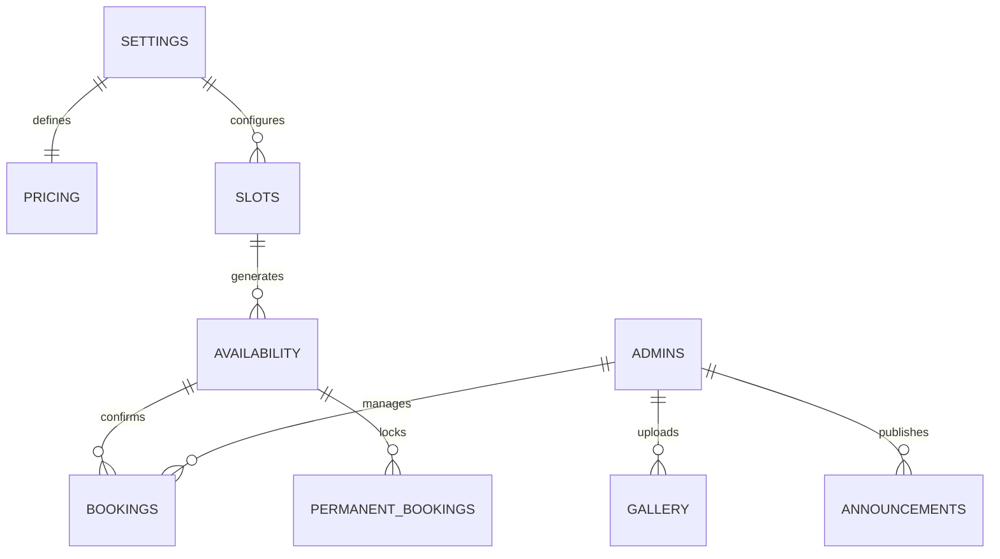
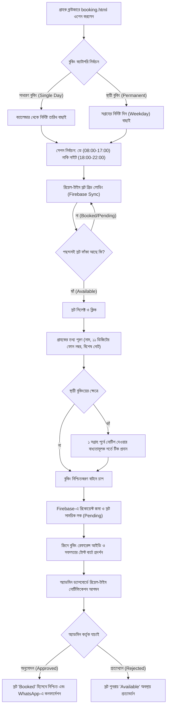

# EVER GAIN — ইনডোর ফুটবল বুকিং প্ল্যাটফর্ম

[](https://developer.mozilla.org/en-US/docs/Web/Progressive_web_apps)
[](https://firebase.google.com/)
[](#license)
[-34d399.svg)](#overview)

> **EVER GAIN** হলো একটি আধুনিক, পূর্ণাঙ্গ ও মোবাইল-ফার্স্ট ইনডোর ফুটবল টার্ফ বুকিং প্ল্যাটফর্ম। এই প্ল্যাটফর্মের মাধ্যমে ফুটবলপ্রেমীরা সহজেই দিনের বা রাতের যেকোনো স্লট রিয়েল-টাইমে চেক করে বুকিং করতে পারেন এবং গ্রাউন্ড কর্তৃপক্ষ অনায়াসে সম্পূর্ণ বুকিং ব্যবস্থা পরিচালনা করতে পারেন।

---

## সূচিপত্র (Table of Contents)

1. [Overview](#overview)
2. [Key Features](#features)
3. [Tech Stack](#tech-stack)
4. [Project Structure](#project-structure)
5. [Firebase Setup & Configuration](#firebase-setup-detailed)
   - [1. Create Firebase Project](#1-create-firebase-project)
   - [2. Enable Realtime Database](#2-enable-realtime-database)
   - [3. Enable Authentication](#3-enable-authentication)
   - [4. Register Admin in Database](#4-register-admin-in-database)
   - [5. Enable Firebase Storage](#5-enable-firebase-storage)
   - [6. Configure Firebase in Project](#6-configure-firebase-in-project)
   - [7. Apply Security Rules](#7-apply-security-rules)
   - [8. Initial Database Seed Data](#8-initial-database-seed-data)
   - [9. Deployment Options](#9-deployment-options)
6. [Database Architecture & Schema](#database-architecture)
7. [Booking Workflow](#booking-flow)
8. [Admin Guide & Control Panel](#admin-guide)
9. [Security Considerations](#security-considerations)
10. [Browser & Device Support](#browser-support)
11. [License](#license)

---

## Overview

**EVER GAIN** is a premier indoor turf football booking and management web application built specifically for sports venues in Bangladesh. The platform combines a cutting-edge dark glassmorphic UI with real-time Firebase backend synchronization, providing an intuitive, instantaneous booking experience for football players and an end-to-end management cockpit for turf owners.

All customer-facing interfaces are localized in standard Bengali (বাংলা) to ensure frictionless adoption, while adhering to the official currency (৳ BDT) and local time standard (`Asia/Dhaka`).

---

## Features

### ⚽ গ্রাহক সুবিধা (Customer Experience)
- **নিয়মিত বুকিং (Regular Single-Day Booking):** গ্রাহকরা ক্যালেন্ডার থেকে দিন নির্বাচন করে ডে (Day: সকাল ৮টা - বিকাল ৫টা) অথবা নাইট (Night: সন্ধ্যা ৬টা - রাত ১০টা) সেশন বেছে নিয়ে তাৎক্ষণিক খালি স্লট বুক করতে পারেন।
- **স্থায়ী বুকিং (Permanent Slot Booking):** প্রতি সপ্তাহের নির্দিষ্ট দিনে নিয়মিত খেলার জন্য স্থায়ী স্লট বুকিং ব্যবস্থা (বিশেষ ছাড়সহ)। বুকিংয়ের সময় শর্তাবলী বাধ্যতামূলকভাবে সম্মতি নেওয়ার ব্যবস্থা রয়েছে (যেমন: বাতিলের জন্য কমপক্ষে ১ সপ্তাহ পূর্বে নোটিশ প্রদান)।
- **রিয়েল-টাইম স্লট স্ট্যাটাস (Real-Time Availability):** Firebase Realtime Database ব্যবহার করায় স্লটের বর্তমান অবস্থা (ফাঁকা, পেন্ডিং, বুকড) কোনো পেজ রিলোড ছাড়াই মুহূর্তের মধ্যে আপডেট হয়।
- **স্বয়ংক্রিয় মূল্য হিসাব (Dynamic Pricing & Discounts):**
  - সাধারণ ডে বুকিং: ~~৳৬০০~~ ৳৫৫০
  - সাধারণ নাইট বুকিং: ৳৯০০
  - স্থায়ী ডে বুকিং: ~~৳৫৫০~~ ৳৫০০ (প্রতি স্লটে ৳৫০ সাশ্রয়)
  - স্থায়ী নাইট বুকিং: ~~৳৯০০~~ ৳৮৫০ (প্রতি স্লটে ৳৫০ সাশ্রয়)
- **মাল্টিমিডিয়া গ্যালারি (Turf Photo & Video Gallery):** গ্রাউন্ডের হাই-রেজোলিউশন ছবি ও ম্যাচ হাইলাইটস ভিডিও দেখার জন্য ফিল্টার ও ফুলস্ক্রিন লাইটবক্স সুবিধা।
- **গ্রাউন্ডের নিয়মাবলী (Ground Rules & Regulations):** জুতা, সময়ানুবর্তিতা, পরিচ্ছন্নতা এবং আচরণ সংক্রান্ত স্পষ্ট নির্দেশিকা।
- **যোগাযোগ ও অভিযোগ বক্স (Contact & Direct WhatsApp):** সরাসরি ফর্মের মাধ্যমে বার্তা পাঠানোর পাশাপাশি এক ক্লিকে অফিশিয়াল হোয়াটসঅ্যাপে চ্যাট করার লিঙ্ক।
- **প্রোগ্রেসিভ ওয়েব অ্যাপ (PWA Support):** যেকোনো অ্যান্ড্রয়েড বা আইওএস ডিভাইসে অ্যাপের মতো ইনস্টল করা যায় এবং ক্যাশিংয়ের মাধ্যমে দ্রুত লোড হয়।

### 🛡️ অ্যাডমিন প্যানেল সুবিধা (Admin Dashboard)
- **নিরাপদ অ্যাডমিন অথেন্টিকেশন (Secure Login):** Firebase Authentication ও ডেটাবেজ-ভেরিফায়েড RBAC।
- **লাইভ বুকিং ম্যানেজমেন্ট (Live Booking Approval):** সাধারণ ও পার্মানেন্ট বুকিং অনুমোদন (Approve), প্রত্যাখ্যান (Reject), বা স্ট্যাটাস পরিবর্তনের সম্পূর্ণ নিয়ন্ত্রণ।
- **স্লট ও সময়সূচী কনফিগারেশন (Slot Schedule Control):** নতুন স্লট তৈরি, সক্রিয়/নিষ্ক্রিয় করা এবং বিশেষ প্রয়োজনে নির্দিষ্ট তারিখ লক করার ক্ষমতা।
- **ডায়নামিক প্রাইসিং আপডেট (Pricing Management):** অ্যাডমিন প্যানেল থেকেই ডে এবং নাইট স্লটের মূল্য ও ডিসকাউন্ট সরাসরি পরিবর্তন করা যায়।
- **ফটো ও ভিডিও আপলোড (Media Management):** সরাসরি ক্লাউড স্টোরেজে ছবি আপলোড ও ক্যাপশনসহ গ্যালারিতে প্রদর্শন।
- **যোগাযোগ বার্তা ইনবক্স (Contact Inbox):** গ্রাহকদের পাঠানো বার্তাগুলো রিয়েল-টাইমে পর্যবেক্ষণ ও উত্তর প্রদান।
- **অ্যানাউন্সমেন্ট ব্যানার (Live Ground Announcements):** বিশেষ অফার বা বন্ধের নোটিশ ওয়েবসাইটের শীর্ষে প্রকাশ করার সুবিধা।

---

## Tech Stack

| প্রযুক্তি (Technology) | ভূমিকা (Role) | বিবরণ (Description) |
| :--- | :--- | :--- |
| **HTML5 & CSS3** | ফ্রন্টএন্ড স্ট্রাকচার ও স্টাইল | আধুনিক Semantic HTML5 এবং কাস্টম Glassmorphism থিমযুক্ত `style.css` |
| **Vanilla JavaScript (ES6+)** | ক্লায়েন্ট লজিক | মডুলার, লাইব্রেরি-নির্ভরতামুক্ত দ্রুতগতির জাভাস্ক্রিপ্ট |
| **Firebase Realtime Database** | ব্যাকএন্ড ও রিয়েলটাইম ডেটা | বুকিং, প্রাপ্যতা ও কনফিগারেশনের তাৎক্ষণিক দ্বি-মুখী সিঙ্ক |
| **Firebase Authentication** | নিরাপত্তা ও লগইন | ইমেইল ও পাসওয়ার্ড ভিত্তিক নিরাপদ অ্যাডমিন লগইন |
| **Firebase Storage** | ফাইল স্টোরেজ | গ্যালারির ছবি ও ভিডিও সংরক্ষণের জন্য ক্লাউড ক্লাউড স্টোরেজ |
| **PWA (Manifest + Service Worker)** | অ্যাপের সুবিধা | অফলাইন ক্যাশিং, হোমস্ক্রিন ইনস্টলেশন এবং নেটওয়ার্ক অপ্টিমাইজেশন |
| **Font Awesome 6.5** | আইকনোগ্রাফি | ব্যবহারকারী ইন্টারফেসের আধুনিক ভেক্টর আইকন |
| **Google Fonts** | টাইপোগ্রাফি | `Inter` (ইংরেজি) ও `Noto Sans Bengali` (বাংলা) |

---

## Project Structure

```text
Ever gain/
├── index.html              # হোমপেজ — ব্যানার, দ্রুত বুকিং, মূল্য তালিকা, সুবিধা ও পূর্বরূপ
├── script.js               # হোমপেজের স্ক্রিপ্ট — পার্টিকেল অ্যানিমেশন ও ডেটা লোডার
├── booking.html            # বুকিং পৃষ্ঠা — ক্যাটাগরি, ক্যালেন্ডার, স্লট নির্বাচন ও ফর্ম
├── booking.js              # বুকিং সিস্টেম লজিক — রিয়েল-টাইম স্লট সিঙ্ক ও বৈধতা যাচাই
├── gallery.html            # মিডিয়া গ্যালারি — ছবি, ভিডিও ও ক্যাটাগরি ফিল্টারিং
├── gallery.js              # গ্যালারি লজিক — লাইটবক্স, ভিডিও প্লেয়ার ও ফিল্টারিং
├── rules.html              # নিয়মাবলী পৃষ্ঠা — টার্ফের ব্যবহারের নিয়ম ও সতর্কতা
├── rules.js                # নিয়মাবলী স্ক্রিপ্ট — ডেটাবেজ থেকে নিয়ম লোডিং
├── contact.html            # যোগাযোগ পৃষ্ঠা — ফর্ম, ঠিকানা, মানচিত্র ও হোয়াটসঅ্যাপ
├── contact.js              # যোগাযোগ লজিক — মেসেজ সাবমিশন ও ভ্যালিডেশন
├── admin.html              # অ্যাডমিন ড্যাশবোর্ড — বুকিং, স্লট, মিডিয়া ও সেটিংস নিয়ন্ত্রণ
├── admin.js                # অ্যাডমিন লজিক — অথেন্টিকেশন, CRUD অপারেশন ও রিয়েল-টাইম টেবিল
├── style.css               # একক পূর্ণাঙ্গ CSS — ডিজাইন সিস্টেমের সমস্ত ক্লাস ও ভ্যারিয়েবল
├── firebase-config.js      # ফায়ারবেস ইনিশিয়ালাইজেশন, রেফারেন্স ও শেয়ার্ড ইউটিলিটি
├── manifest.json           # PWA ওয়েব অ্যাপ ম্যানিফেস্ট
├── service-worker.js       # PWA সার্ভিস ওয়ার্কার (ক্যাশিং ও অফলাইন সাপোর্ট)
├── README.md               # সম্পূর্ণ প্রজেক্ট ডকুমেন্টেশন
└── assets/                 # স্থির মিডিয়া ফাইলসমূহ
    ├── icons/              # PWA অ্যাপ আইকন (192x192, 512x512 ইত্যাদি)
    ├── images/             # টার্ফ ও প্রিভিউ ছবি
    ├── logo/               # অফিশিয়াল এভার গেইন লোগো
    └── videos/             # ম্যাচ হাইলাইটস ভিডিও ফাইল
```

---

## Firebase Setup (DETAILED)

এই প্রজেক্টটি পরিচালিত হয় Google Firebase সার্ভিসের ওপর। প্রজেক্টটি চালু করার জন্য নিচের ধাপগুলো মনোযোগ সহকারে অনুসরণ করুন:

### 1. Create Firebase Project
1. আপনার ব্রাউজারে [Firebase Console](https://console.firebase.google.com) ওপেন করুন।
2. **Add project** (বা 'Create a project') বাটনে ক্লিক করুন।
3. প্রজেক্টের নাম লিখুন: `ever-gain` (অথবা আপনার পছন্দসই নাম)।
4. Google Analytics সক্রিয় বা নিষ্ক্রিয় করতে পারেন (ঐচ্ছিক)।
5. **Create project** বাটনে ক্লিক করুন এবং প্রজেক্ট প্রস্তুত হওয়া পর্যন্ত অপেক্ষা করুন।

### 2. Enable Realtime Database
1. বাম পাশের নেভিগেশন মেনু থেকে **Build → Realtime Database**-এ ক্লিক করুন।
2. **Create Database** বাটনে ক্লিক করুন।
3. ডেটাবেজের অবস্থান (Location) নির্বাচন করুন: বাংলাদেশের সবচেয়ে নিকটবর্তী অঞ্চল হিসেবে **Singapore (`asia-southeast1`)** সিলেক্ট করুন।
4. Security Rules নির্ধারণের ধাপে **Start in test mode** নির্বাচন করুন (আমরা পরবর্তী ধাপে নির্দিষ্ট রুলস সেট করব)।
5. ডাটাবেজ তৈরি সম্পন্ন হলে উপরের ডেটাবেজ URL-টি সংরক্ষণ করুন (উদাহরণ: `https://ever-gain-default-rtdb.asia-southeast1.firebasedatabase.app`).

### 3. Enable Authentication
1. বাম পাশের মেনু থেকে **Build → Authentication**-এ যান।
2. **Get started** বাটনে ক্লিক করুন।
3. **Sign-in method** ট্যাব থেকে **Email/Password** নির্বাচন করে **Enable** করে **Save** দিন।
4. প্রধান অ্যাডমিন একাউন্ট তৈরির জন্য:
   - **Users** ট্যাবে যান।
   - **Add user** বাটনে ক্লিক করুন।
   - আপনার পছন্দের অ্যাডমিন ইমেইল (যেমন: `admin@evergain.com`) এবং একটি শক্তিশালী পাসওয়ার্ড প্রবেশ করান।
   - একাউন্ট তৈরি হলে তৈরি হওয়া ব্যবহারকারীর **User UID** কপি করে নিন।

### 4. Register Admin in Database
অ্যাডমিন প্যানেলে অনুমোদিত প্রবেশাধিকার নিশ্চিত করতে Firebase Realtime Database-এ অ্যাডমিনের UID এন্ট্রি করতে হবে:
1. **Realtime Database** ট্যাবে যান।
2. রুট নোডের ডানে `+` আইকনে ক্লিক করে নিচের স্ট্রাকচার অনুযায়ী ডেটা ম্যানুয়ালি যোগ করুন:

```json
{
  "admins": {
    "PASTE_ADMIN_UID_HERE": {
      "email": "admin@evergain.com",
      "role": "admin",
      "name": "Admin",
      "createdAt": 1730386800000
    }
  }
}
```
> [!IMPORTANT]
> `PASTE_ADMIN_UID_HERE`-এর জায়গায় Authentication ট্যাবে তৈরি হওয়া অ্যাডমিন ব্যবহারকারীর সঠিক UID প্রতিস্থাপন করতে হবে।

### 5. Enable Firebase Storage
1. বাম পাশের মেনু থেকে **Build → Storage**-এ ক্লিক করুন।
2. **Get started** বাটনে ক্লিক করুন।
3. ক্লাউড স্টোরেজ সিকিউরিটিতে **Start in test mode** সিলেক্ট করে **Next** দিন।
4. ক্লাউড স্টোরেজের লোকেশন হিসেবে `asia-southeast1` বা ডিফল্ট সিলেক্ট করে **Done** দিন।

### 6. Configure Firebase in Project
1. Firebase Console-এর শীর্ষে থাকা গিয়ার আইকন (Project Settings) → **General** ট্যাবে যান।
2. 'Your apps' সেকশনে থাকা ওয়েব আইকনে (`</>`) ক্লিক করুন।
3. App nickname হিসেবে `EVER GAIN Web` লিখুন এবং **Register app** চাপুন।
4. কনসোল থেকে তৈরি হওয়া `firebaseConfig` অবজেক্টটি কপি করুন।
5. আপনার প্রজেক্টের রুট ডিরেক্টরিতে থাকা [`firebase-config.js`](file:///data/user/0/com.termux/files/home/storage/shared/program/Ever%20gain/firebase-config.js) ফাইলটি খুলুন এবং কনফিগারেশন ভ্যালুগুলো আপডেট করুন:

```javascript
// firebase-config.js
const firebaseConfig = {
  apiKey: "AIzaSyYourActualApiKeyHere12345678",
  authDomain: "ever-gain.firebaseapp.com",
  databaseURL: "https://ever-gain-default-rtdb.asia-southeast1.firebasedatabase.app",
  projectId: "ever-gain",
  storageBucket: "ever-gain.appspot.com",
  messagingSenderId: "123456789012",
  appId: "1:123456789012:web:abcdef1234567890"
};

// Initialize Firebase
firebase.initializeApp(firebaseConfig);
const db = firebase.database();
const auth = firebase.auth();
const storage = firebase.storage();
```

---

### 7. Apply Security Rules

নিরাপত্তা ও অননুমোদিত অ্যাক্সেস রোধে নিচের সিকিউরিটি রুলগুলো সরাসরি ফায়ারবেস কনসোলে পেস্ট করুন।

#### ক. Realtime Database Rules
Firebase Console-এ **Realtime Database → Rules** ট্যাবে যান, বিদ্যমান লেখা মুছে নিচের রুলসটি সংরক্ষণ করুন:

```json
{
  "rules": {
    "settings": {
      ".read": true,
      ".write": "auth != null && root.child('admins').child(auth.uid).exists()"
    },
    "pricing": {
      ".read": true,
      ".write": "auth != null && root.child('admins').child(auth.uid).exists()"
    },
    "slots": {
      ".read": true,
      ".write": "auth != null && root.child('admins').child(auth.uid).exists()"
    },
    "availability": {
      ".read": true,
      ".write": "auth != null && root.child('admins').child(auth.uid).exists()"
    },
    "bookings": {
      ".read": "auth != null && root.child('admins').child(auth.uid).exists()",
      ".write": true,
      "$bookingId": {
        ".validate": "newData.hasChildren(['customerName', 'customerPhone', 'session', 'slotId', 'status', 'createdAt'])",
        "status": {
          ".write": "auth != null && root.child('admins').child(auth.uid).exists()"
        }
      }
    },
    "permanentBookings": {
      ".read": "auth != null && root.child('admins').child(auth.uid).exists()",
      ".write": true,
      "$bookingId": {
        ".validate": "newData.hasChildren(['customerName', 'customerPhone', 'session', 'slotId', 'weekday', 'conditionAccepted', 'status'])",
        "status": {
          ".write": "auth != null && root.child('admins').child(auth.uid).exists()"
        }
      }
    },
    "gallery": {
      ".read": true,
      ".write": "auth != null && root.child('admins').child(auth.uid).exists()"
    },
    "rules": {
      ".read": true,
      ".write": "auth != null && root.child('admins').child(auth.uid).exists()"
    },
    "admins": {
      ".read": "auth != null && root.child('admins').child(auth.uid).exists()",
      ".write": false
    },
    "contactMessages": {
      ".read": "auth != null && root.child('admins').child(auth.uid).exists()",
      ".write": true,
      "$messageId": {
        ".validate": "newData.hasChildren(['name', 'phone', 'message', 'createdAt'])"
      }
    },
    "announcements": {
      ".read": true,
      ".write": "auth != null && root.child('admins').child(auth.uid).exists()"
    },
    "blockedDates": {
      ".read": true,
      ".write": "auth != null && root.child('admins').child(auth.uid).exists()"
    }
  }
}
```

#### খ. Storage Rules
Firebase Console-এ **Storage → Rules** ট্যাবে যান এবং নিচের কোডটি পেস্ট করে **Publish** করুন:

```javascript
rules_version = '2';
service firebase.storage {
  match /b/{bucket}/o {
    // Gallery images & videos can be viewed by anyone, uploaded only by admins
    match /gallery/{allPaths=**} {
      allow read: if true;
      allow write: if request.auth != null;
    }
    // General fallback
    match /{allPaths=**} {
      allow read: if true;
      allow write: if request.auth != null;
    }
  }
}
```

---

### 8. Initial Database Seed Data

প্রজেক্টটি প্রথমবার চালুর সময় ডিফল্ট স্লট, প্রিমিয়াম প্রাইসিং এবং নিয়মাবলী অন্তর্ভুক্ত করতে নিচের JSON ফাইলটি Realtime Database-এর মূল রুটে Import করতে পারেন (Console-এ তিনটি ডট মেনু `...` থেকে **Import JSON** সিলেক্ট করুন):

```json
{
  "pricing": {
    "normalDay": 550,
    "normalNight": 900,
    "permanentDay": 500,
    "permanentNight": 850,
    "dayOriginal": 600,
    "nightOriginal": 900
  },
  "slots": {
    "day": {
      "slot_d1": { "startTime": "08:00", "endTime": "09:00", "active": true, "label": "০৮:০০ - ০৯:০০ AM" },
      "slot_d2": { "startTime": "09:00", "endTime": "10:00", "active": true, "label": "০৯:০০ - ১০:০০ AM" },
      "slot_d3": { "startTime": "10:00", "endTime": "11:00", "active": true, "label": "১০:০০ - ১১:০০ AM" },
      "slot_d4": { "startTime": "11:00", "endTime": "12:00", "active": true, "label": "১১:০০ - ১২:০০ PM" },
      "slot_d5": { "startTime": "14:00", "endTime": "15:00", "active": true, "label": "০২:০০ - ০৩:০০ PM" },
      "slot_d6": { "startTime": "15:00", "endTime": "16:00", "active": true, "label": "০৩:০০ - ০৪:০০ PM" },
      "slot_d7": { "startTime": "16:00", "endTime": "17:00", "active": true, "label": "০৪:০০ - ০৫:০০ PM" }
    },
    "night": {
      "slot_n1": { "startTime": "18:00", "endTime": "19:00", "active": true, "label": "০৬:০০ - ০৭:০০ PM" },
      "slot_n2": { "startTime": "19:00", "endTime": "20:00", "active": true, "label": "০৭:০০ - ০৮:০০ PM" },
      "slot_n3": { "startTime": "20:00", "endTime": "21:00", "active": true, "label": "০৮:০০ - ০৯:০০ PM" },
      "slot_n4": { "startTime": "21:00", "endTime": "22:00", "active": true, "label": "০৯:০০ - ১০:০০ PM" }
    }
  },
  "settings": {
    "groundName": "EVER GAIN Indoor Football",
    "phone": "+8801700000000",
    "whatsapp": "+8801700000000",
    "address": "মিরপুর, ঢাকা, বাংলাদেশ",
    "mapLink": "https://maps.google.com",
    "hours": "সকাল ৮:০০ - রাত ১০:০০",
    "heroTitle": "আপনার ইনডোর ফুটবলের সেরা গন্তব্য",
    "heroSubtitle": "প্রিমিয়াম ইনডোর ফুটবল গ্রাউন্ড - সহজেই স্লট বুকিং দিন",
    "socialFacebook": "https://facebook.com/evergainfootball",
    "socialInstagram": "https://instagram.com/evergainfootball"
  },
  "rules": {
    "rule1": { "icon": "fa-clock", "title": "সময়মতো উপস্থিত থাকুন", "description": "বুকিং করা সময়ের অন্তত ১০ মিনিট পূর্বে গ্রাউন্ডে উপস্থিত হতে হবে।", "order": 1 },
    "rule2": { "icon": "fa-shoe-prints", "title": "উপযুক্ত স্পোর্টস শু পরিধান", "description": "টার্ফে খেলার উপযোগী টার্ফ শু বা স্নিকার্স বাধ্যতামূলক। মেটাল স্পাইকযুক্ত জুতো সম্পূর্ণ নিষিদ্ধ।", "order": 2 },
    "rule3": { "icon": "fa-ban-smoking", "title": "ধূমপান ও পানাহার নিষিদ্ধ", "description": "গ্রাউন্ডের অভ্যন্তরে ধূমপান, ক্ষতিকর পানীয় বা খাবার গ্রহণ সম্পূর্ণ নিষিদ্ধ।", "order": 3 },
    "rule4": { "icon": "fa-handshake", "title": "খেলোয়াড়সুলভ আচরণ", "description": "রেফারি, গ্রাউন্ড কর্মকর্তা এবং বিপক্ষ দলের সাথে সম্মানজনক ও সৌজন্যমূলক আচরণ বজায় রাখুন।", "order": 4 },
    "rule5": { "icon": "fa-futbol", "title": "সরঞ্জামের সঠিক যত্ন", "description": "গ্রাউন্ডের পোস্ট, নেট ও বলের যত্ন নিন। কোনো ক্ষয়ক্ষতির জন্য ক্ষতিপূরণ প্রযোজ্য হবে।", "order": 5 },
    "rule6": { "icon": "fa-trash-can", "title": "পরিচ্ছন্নতা বজায় রাখা", "description": "ব্যবহৃত বোতল ও ময়লা নির্দিষ্ট ডাস্টবিনে ফেলুন এবং টার্ফ পরিষ্কার রাখুন।", "order": 6 }
  },
  "announcements": {
    "banner1": {
      "message": "🔥 সীমিত সময়ের অফার! ডে সেশনে প্রতি স্লটে ৫০ টাকা নগদ ছাড় চলছে!",
      "active": true,
      "type": "info"
    }
  }
}
```

---

### 9. Deployment Options

EVER GAIN একটি ক্লায়েন্ট-সাইড স্ট্যাটিক ওয়েব অ্যাপ্লিকেশন যা যেকোনো স্ট্যাটিক হোস্টিং প্ল্যাটফর্মে নিরবচ্ছিন্নভাবে পরিচালনা করা সম্ভব।

#### অপশন ১: Firebase Hosting (সর্বোত্তম ও সুপারিশকৃত)
Firebase প্রজেক্টের সাথে ইন্টিগ্রেশন এবং হাই-স্পিড CDN সুবিধার জন্য এটি সেরা:
1. নোড প্যাকেজ ম্যানেজার দিয়ে Firebase CLI ইনস্টল করুন:
   ```bash
   npm install -g firebase-tools
   ```
2. আপনার গুগল একাউন্টে লগইন করুন:
   ```bash
   firebase login
   ```
3. প্রজেক্ট ফোল্ডারে টার্মিনাল খুলে Firebase ইনিশিয়ালাইজ করুন:
   ```bash
   firebase init hosting
   ```
   - **Use an existing project** নির্বাচন করে আপনার তৈরি করা `ever-gain` প্রজেক্টটি সিলেক্ট করুন।
   - **What do you want to use as your public directory?** লিখে এন্টার চাপুন: `.` (বর্তমান ডিরেক্টরি)।
   - **Configure as a single-page app (rewrite all urls to /index.html)?** `N` (না চাপুন, কারণ এটি মাল্টি-পেজ সাইট)।
   - **Set up automatic builds and deploys with GitHub?** `N` বা আপনার প্রয়োজন অনুযায়ী `Y`।
4. হোস্টিংয়ে সরাসরি ডিপ্লয় করতে রান করুন:
   ```bash
   firebase deploy --only hosting
   ```
5. কমান্ড লাইনে আপনার লাইভ ওয়েবসাইটের লিঙ্ক (`https://ever-gain.web.app`) প্রদর্শিত হবে!

#### অপশন ২: অন্যান্য স্ট্যাটিক হোস্টিং (Vercel, Netlify, GitHub Pages)
- **Netlify:** প্রজেক্ট ফোল্ডারটি সরাসরি Netlify ড্রপবক্সে টেনে আনুন অথবা GitHub রিপোজিটরির সাথে সংযুক্ত করুন।
- **Vercel:** `vercel deploy` কমান্ড রান করুন অথবা GitHub রেপোর সাথে কানেক্ট করুন।
- **GitHub Pages:** রিপোজিটরির `Settings → Pages`-এ গিয়ে `main` বা `gh-pages` ব্রাঞ্চ নির্বাচন করে সেভ করুন।

---

## Database Architecture

Firebase Realtime Database-এর স্কিমা ও ডাটা নোডসমূহের পূর্ণাঙ্গ বিবরণ:



### নোডসমূহের বিবরণ:

| নোড পাথ (Path) | অনুমতি (Access) | বিবরণ (Description) |
| :--- | :--- | :--- |
| `/settings` | Public Read / Admin Write | গ্রাউন্ডের মৌলিক তথ্য (ফোন নম্বর, ঠিকানা, মানচিত্র, কার্যকাল, সোশ্যাল লিঙ্ক)। |
| `/pricing` | Public Read / Admin Write | ডে ও নাইট সেশনের সাধারণ ও স্থায়ী বুকিংয়ের রিয়েল-টাইম মূল্য তালিকা। |
| `/slots/day` & `/slots/night` | Public Read / Admin Write | সমস্ত স্লটের সময়সূচী, শুরুর সময়, শেষের সময় ও সক্রিয়তা স্ট্যাটাস। |
| `/availability/{date}/{slotId}` | Public Read / Admin Write | নির্দিষ্ট তারিখ ও স্লটের রিয়েল-টাইম প্রাপ্যতা (`status`: `available`, `pending`, `booked`)। |
| `/bookings/{bookingId}` | Public Write / Admin Read & Write | সাধারণ একক-দিনের স্লট বুকিংয়ের বিস্তারিত তথ্য (নাম, ফোন, তারিখ, সময়, মূল্য, স্ট্যাটাস)। |
| `/permanentBookings/{bookingId}` | Public Write / Admin Read & Write | সপ্তাহের নির্দিষ্ট দিনে নিয়মিত স্থায়ী বুকিং (সপ্তাহের দিন, গ্রাহকের সম্মতি, স্ট্যাটাস)। |
| `/gallery/{itemId}` | Public Read / Admin Write | গ্যালারির ছবি ও ভিডিও আইটেম (শিরোনাম, মিডিয়া URL, টাইপ: photo/video, আপলোডের তারিখ)। |
| `/rules/{ruleId}` | Public Read / Admin Write | টার্ফের ডিসিপ্লিনারি ও সেফটি নির্দেশাবলী (আইকন, শিরোনাম, বর্ণনা ও ডিসপ্লে অর্ডার)। |
| `/admins/{uid}` | Admin Read Only / No Public Write | অনুমোদিত অ্যাডমিনদের UID তালিকা, রোল ও যোগাযোগের ইমেইল। |
| `/contactMessages/{messageId}` | Public Write / Admin Read | গ্রাহকদের প্রেরিত যোগাযোগ ও ফিডব্যাক মেসেজ (নাম, ফোন নম্বর, মেসেজ, সময়)। |
| `/announcements/{announcementId}` | Public Read / Admin Write | ওয়েবসাইটে প্রদর্শিত লাইভ ব্যানার বার্তা বা জরুরি নোটিস। |
| `/blockedDates/{dateKey}` | Public Read / Admin Write | রক্ষণাবেক্ষণ বা ছুটির কারণে পুরোপুরি বন্ধ রাখা তারিখের তালিকা। |

---

## Booking Flow



---

## Admin Guide

অ্যাডমিন প্যানেলটি গ্রাউন্ডের পুরো কার্যক্রম একক ড্যাশবোর্ড থেকে সহজে পরিচালনার জন্য তৈরি করা হয়েছে।

### ১. অ্যাডমিন প্যানেলে লগইন
1. ব্রাউজারে `admin.html` লিঙ্কে প্রবেশ করুন।
2. Firebase Authentication-এ রেজিস্টার করা অ্যাডমিন ইমেইল ও পাসওয়ার্ড প্রদান করে **লগইন করুন** বাটনে চাপুন।
3. সফল লগইনের পর সম্পূর্ণ ড্যাশবোর্ড লোড হবে। যেকোনো অননুমোদিত ব্যবহারকারী সরাসরি অ্যাক্সেস করতে পারবে না।

### ২. বুকিং রিকোয়েস্ট পরিচালনা
- **সাধারণ বুকিং ট্যাব:** গ্রাহকদের জমা দেওয়া সমস্ত ডে ও নাইট বুকিং রিকোয়েস্ট দেখতে পাবেন।
  - গ্রাহকের ফোন নম্বরে সরাসরি কল বা হোয়াটসঅ্যাপ করার সুবিধাজনক বাটন রয়েছে।
  - **অনুমোদন (Approve):** স্লটটিকে পাকাপোক্তভাবে বুকড হিসেবে চিহ্নিত করে।
  - **বাতিল (Reject):** বুকিং বাতিল করে স্লটটিকে সবার জন্য পুনরায় উন্মুক্ত করে দেয়।
- **স্থায়ী বুকিং ট্যাব:** যেসব দল প্রতি সপ্তাহে নির্দিষ্ট স্লটে খেলে, তাদের পরিচালনা করার আলাদা ট্যাব। সক্রিয় (Active) বা সাময়িক স্থগিত (Paused) রাখার অপশন বিদ্যমান।

### ৩. স্লট ও তারিখ ব্লক ব্যবস্থাপনা
- সংস্কার কাজ, বৈরী আবহাওয়া বা ব্যক্তিগত টুর্নামেন্টের জন্য যেকোনো তারিখ বা নির্দিষ্ট স্লট এক ক্লিকেই সাময়িক বন্ধ (Block) করে রাখা যায়।

### ৪. ডায়নামিক রেট ও ডিসকাউন্ট পরিবর্তন
- 'Pricing & Settings' সেকশন থেকে যেকোনো সময় ডে সেশন বা নাইট সেশনের প্রতি ঘণ্টার রেট আপডেট করা যায়, যা হোমপেজ ও বুকিং পেজে সাথে সাথে পরিবর্তিত হয়।

### ৫. গ্যালারি ও ফটো আপলোড
- 'Gallery Management' সেকশন থেকে নতুন তোলা গ্রাউন্ডের ম্যাচ বা লাইটিংয়ের ছবি আপলোড করা যায়। ছবির শিরোনাম এবং ট্যাগ (ডে ম্যাচ/নাইট ম্যাচ/ইভেন্ট) নির্ধারণ করা যায়।

---

## Security Considerations

- **ক্লায়েন্ট ও সার্ভার দ্বিস্তরীয় যাচাই (Two-Tier Validation):** ওয়েব পেজে রেগুলার এক্সপ্রেশন দিয়ে গ্রাহকের ফোন নম্বর ও স্লট নির্বাচন যাচাই করার পাশাপাশি Firebase Security Rules নিশ্চিত করে যেন কোনো অবৈধ ডাটা ডাটাবেজে প্রবেশ করতে না পারে।
- **অ্যাডমিন আইডেন্টিটি ভেরিফিকেশন (RBAC):** শুধুমাত্র অথেন্টিকেটেড ব্যবহারকারী হওয়াই যথেষ্ট নয়; Firebase Realtime Database-এর `/admins/{uid}` নোডে ব্যবহারকারীর UID উপস্থিত থাকলে তবেই ডাটা পরিবর্তন বা গ্রাহকদের স্পর্শকাতর তথ্য পড়ার অধিকার পায়।
- **সংবেদনশীল ডেটা গোপনীয়তা:** গ্রাহকদের বুকিং ডেটা সাধারণ ভিজিটরদের কাছে পৌঁছায় না। শুধুমাত্র নির্দিষ্ট স্লটটি বুকড কি না, সেই স্ট্যাটাস পাবলিক ভিউতে যায়।
- **রেট লিমিটিং ও ইনজেকশন প্রতিরোধ:** স্ট্যাটিক ক্লায়েন্ট অ্যাপ্লিকেশন হওয়ায় এসকিউএল ইনজেকশনের কোনো সুযোগ নেই।

---

## Browser Support

EVER GAIN সমস্ত আধুনিক ব্রাউজারে রেসপন্সিভ এবং ফ্লুইড পারফরম্যান্স নিশ্চিত করার জন্য পরীক্ষিত:

| ব্রাউজার (Browser) | সাপোর্ট লেভেল (Support) | নোট (Notes) |
| :--- | :--- | :--- |
| **Google Chrome (Android)** | ⭐️⭐️⭐️⭐️⭐️ (পূর্ণাঙ্গ) | প্রাথমিক টার্গেট ডিভাইস, PWA ইনস্টল সাপোর্টসহ |
| **Google Chrome (Desktop)** | ⭐️⭐️⭐️⭐️⭐️ (পূর্ণাঙ্গ) | স্মুথ ক্যানভাস পার্টিকেল ও লাইটবক্স |
| **Mozilla Firefox** | ⭐️⭐️⭐️⭐️⭐️ (পূর্ণাঙ্গ) | সিএসএস গ্রিড ও গ্লাস মরফিজম সম্পূর্ণ সমর্থিত |
| **Apple Safari (iOS & macOS)** | ⭐️⭐️⭐️⭐️⭐️ (পূর্ণাঙ্গ) | WebKit ব্যাকড্রপ ব্লার ও টাচ অপ্টিমাইজড |
| **Samsung Internet** | ⭐️⭐️⭐️⭐️⭐️ (পূর্ণাঙ্গ) | পূর্ণাঙ্গ মোবাইল লেআউট সাপোর্ট |
| **Microsoft Edge** | ⭐️⭐️⭐️⭐️⭐️ (পূর্ণাঙ্গ) | আধুনিক Chromium ইঞ্জিন ভিত্তিক |

---

## License

© 2026 **EVER GAIN**. সর্বস্বত্ব সংরক্ষিত (All rights reserved).
অনুমতি ব্যতীত এই কোড বা ডিজাইন বাণিজ্যিক উদ্দেশ্যে নকল করা আইনত দণ্ডনীয়।

---

*নির্মিত হয়েছে পেশাদার ক্রীড়াপ্রেমী ও ফুটবল কমিউনিটির আন্তরিক সহযোগিতায়।* ⚽🔥
